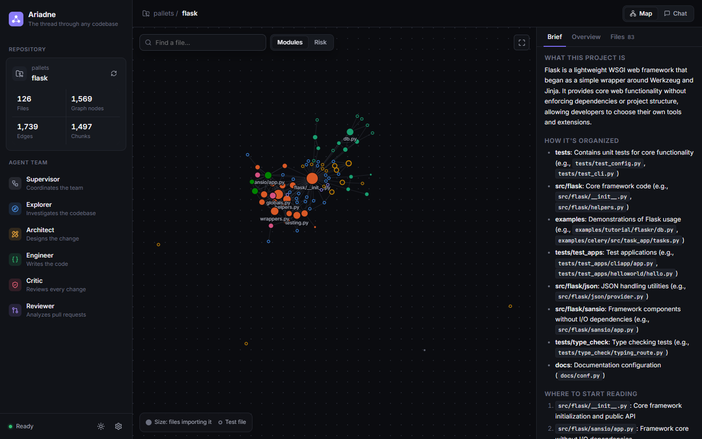
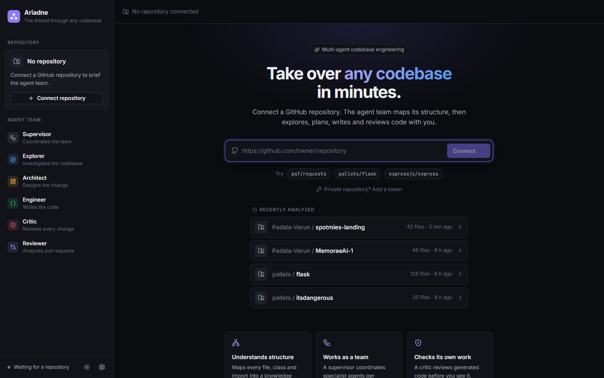
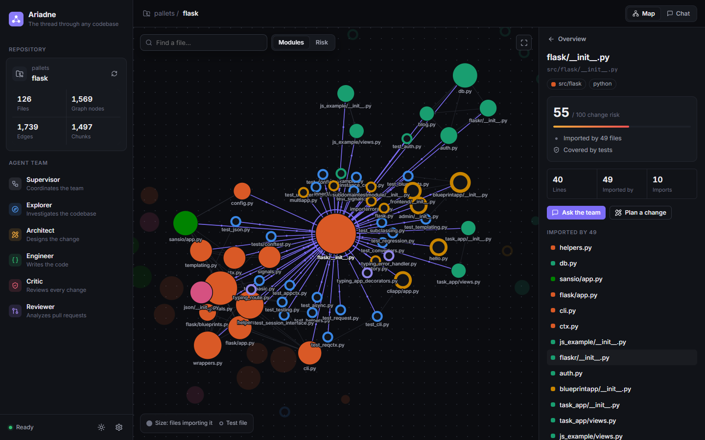
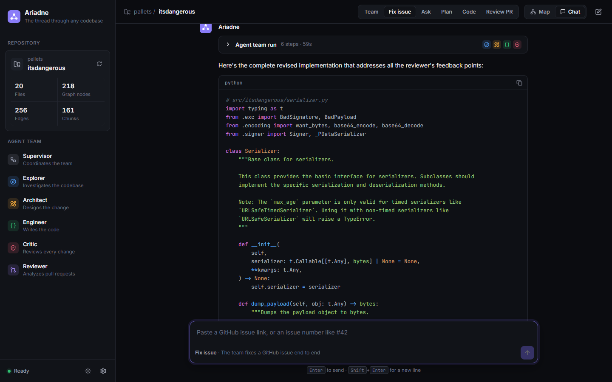
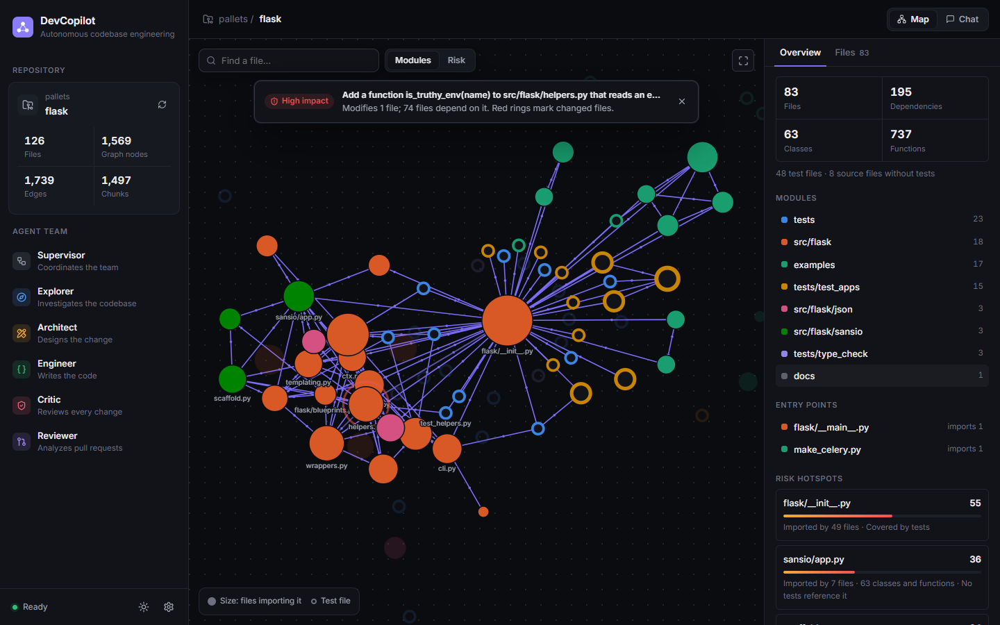
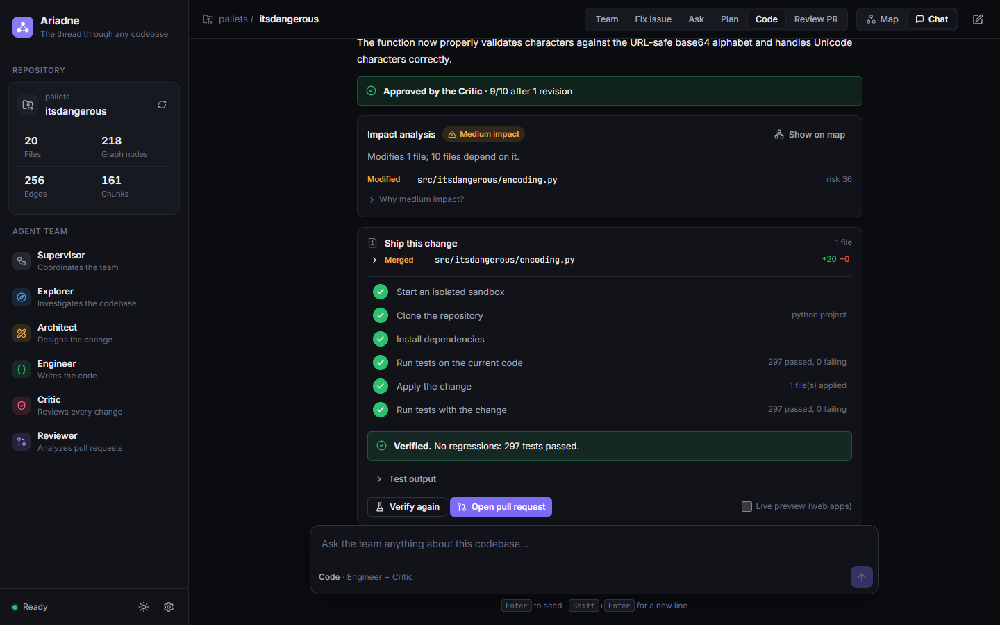
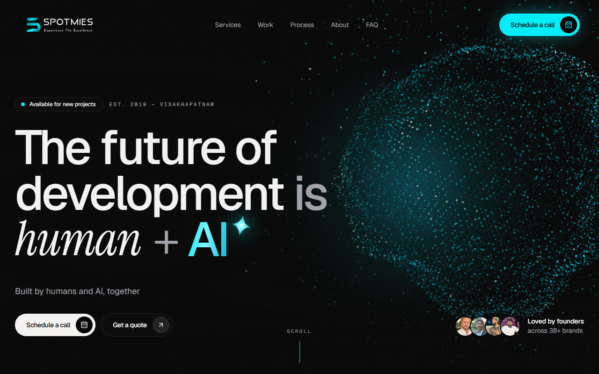
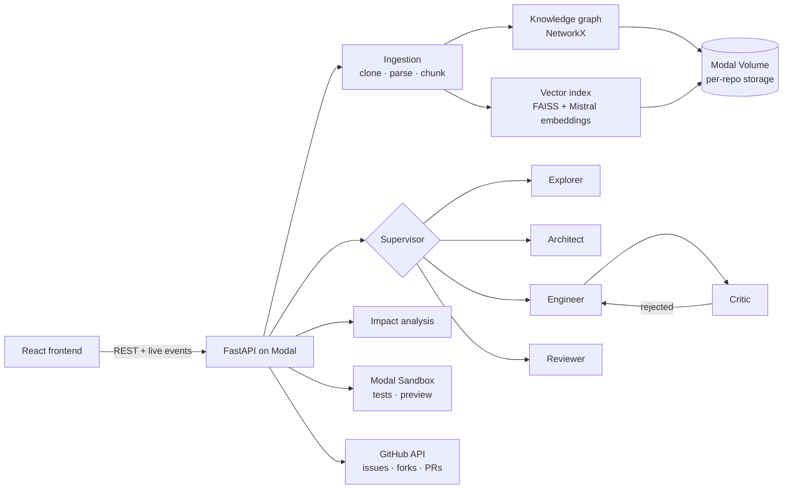

# Ariadne

**The thread through any codebase.** Ariadne is a team of AI agents that takes over an unfamiliar repository: it maps the architecture, answers questions, fixes GitHub issues, checks what a change affects, proves the fix with the repository's own tests in a sandbox, and opens the pull request.




## Why

When a team inherits a codebase, the first weeks go to reading code nobody documented, guessing which files are risky to touch, and hoping a change doesn't break something three modules away. Code assistants help write code, but they don't know the repository's structure, can't say what a change will break, and can't prove their code works.

Ariadne works from a **knowledge graph** of the repository (every file, class, function and import) plus semantic search, and it checks its own work twice: a Critic agent reviews every change, and a sandbox runs the project's real test suite before anything is merged.

## What it does

| Stage | What happens |
|---|---|
| **Understand** | Paste a GitHub link. Ariadne indexes the repo and shows an interactive architecture map (modules, entry points, risk hotspots) next to a one-page onboarding brief. |
| **Ask** | A supervisor agent assembles the right specialists for each request; you watch them work live. Follow-up questions keep the conversation's context. |
| **Fix** | Paste a GitHub issue. The team investigates, plans, writes the fix and tests, and the Critic reviews it, sending it back for revision when needed. |
| **Protect** | Before you ship, impact analysis walks the import graph to show every file that depends on the change, with a Low/Medium/High rating and reasons, highlighted on the map. |
| **Verify** | One click runs the repository's tests in an isolated sandbox, before and after the change, and reports regressions. Failures go back to the Engineer with the test output. Web apps get a live preview link. |
| **Ship** | Review the exact diff, then open a pull request with the review, impact analysis and test results in its description. Repositories you can't push to are forked automatically. |

## The agent team

| Agent | Role |
|---|---|
| **Supervisor** | Decides which agent acts next, and when the request is done |
| **Explorer** | Investigates the codebase and explains how things work |
| **Architect** | Writes low-level design plans |
| **Engineer** | Writes code, as complete files with their repository paths |
| **Critic** | Reviews every code change; rejected code goes back for revision (up to two rounds) |
| **Reviewer** | Analyzes existing pull requests |

## Screenshots

| | |
|---|---|
|  |  |
| **Connect** a repository; recently analyzed repos reopen instantly | **Inspect** any file: risk score with reasons, dependents, dependencies |
|  |  |
| **Fix** a GitHub issue with the full team | **Protect**: the changed file pulses red; its dependents are highlighted |
|  |  |
| **Verify**: 297 tests before and after, no regressions | **Preview**: the changed site served from a sandbox (new subtitle) |

## Architecture



- **Retrieval:** each request searches the FAISS index and expands the hits through the knowledge graph; follow-ups are searched together with the previous question.
- **Orchestration:** a LangGraph state machine. Agents share their outputs, so the Engineer implements the Architect's plan and the Critic sees the impact analysis.
- **Change preparation:** generated code is turned into complete files. When the Engineer returns only a changed function, it's merged into the current file from GitHub, so committing never wipes out the rest of the file.
- **Verification:** a Modal Sandbox clones the repo, installs dependencies (pip, `pyproject` dependency groups, npm), runs pytest or `npm test` on the original code and on the change, and compares the results.

## Tech stack

- **Backend:** Python 3.11, FastAPI, LangGraph, LangChain, NetworkX, FAISS
- **AI:** Mistral (`codestral-latest` for the agents, `mistral-embed` for embeddings)
- **Infrastructure:** Modal (API hosting, persistent Volume, sandboxes for tests and previews)
- **Frontend:** React 18, Vite, react-force-graph, react-markdown, lucide icons

## Run it locally

**Requirements:** Python 3.11+, Node.js 18+, a [Mistral API key](https://console.mistral.ai/api-keys), a GitHub token (classic, `repo` scope) for issues and pull requests, and a [Modal](https://modal.com) account for sandbox verification.

```bash
# Backend
cd backend
python -m venv .venv && .venv/Scripts/activate      # macOS/Linux: source .venv/bin/activate
pip install -r requirements.txt
cp .env.example .env                                # add MISTRAL_API_KEY and GITHUB_TOKEN
modal token new                                     # sandboxes run in your Modal account
python main.py                                      # http://localhost:8000 (docs at /docs)

# Frontend (second terminal)
cd frontend
npm install
VITE_API_BASE=/api npm run dev                      # http://localhost:5173
```

## Deploy

```bash
cd backend
modal secret create devcopilot-secrets --from-dotenv .env --force   # once, or when keys change
modal deploy modal_deploy.py
```

The deployed API keeps each indexed repository on the `devcopilot-data` Modal Volume and stays warm for 20 minutes after the last request. Point `frontend/.env.production` at the deployed URL and build the frontend with `npm run build`.

## API

| Endpoint | Purpose |
|---|---|
| `POST /api/ingest` | Index a repository (returns a repo id; reopens cached repos instantly) |
| `GET /api/status?repo=` | Indexing progress and stats |
| `GET /api/repos` | Repositories saved on the server |
| `GET /api/graph?repo=` | Architecture map: files, imports, modules, entry points, risk |
| `GET /api/brief?repo=` | Onboarding brief (generated once, then cached) |
| `POST /api/query/stream` | Ask the agent team; streams live progress as Server-Sent Events |
| `GET /api/issue?repo=&ref=` | Fetch a GitHub issue and build the team's task from it |
| `POST /api/changes/prepare` | Complete files and diffs for generated code |
| `POST /api/verify` | Run the tests in a sandbox (optionally start a preview); streams progress |
| `POST /api/create-pr` | Commit to a new branch (forking if needed) and open a pull request |

## Project structure

```
backend/
  main.py, config.py          FastAPI app and settings
  api/routes.py               HTTP endpoints
  api/github_pr.py            branches, commits, forks, pull requests
  api/github_issues.py        issue fetching
  agents/                     supervisor, Explorer, Architect, Engineer, Critic, Reviewer
  agents/llm.py               shared LLM client with pacing and retries
  ingestion/                  clone, parse, chunk
  knowledge_graph/            graph builder, import resolver, map, impact analysis
  vector_store/               Mistral embeddings, FAISS index
  workspace.py                per-repository sessions and persistence
  changes.py                  merging generated code into complete files, diffs
  sandbox.py                  test runs and previews in Modal Sandboxes
  brief.py                    onboarding brief
  modal_deploy.py             Modal deployment
frontend/src/
  App.jsx                     shell: map and chat views
  components/RepoMap.jsx      architecture map, brief, impact view
  components/Chat.jsx         conversation, Fix issue mode
  components/ChangeReview.jsx diff review, sandbox verification, preview
  components/AgentRun.jsx     live agent timeline
```

## Limitations

- **Model quality caps fix quality.** On the free Mistral tier only the Codestral family is available; hard bugs may need several rounds or a stronger model (set `LLM_MODEL`). The sandbox reports failures honestly either way.
- **Verification needs a runnable test suite.** Python (pytest) and JavaScript (`npm test`) projects are supported; projects that need databases, secrets or Docker can't be fully tested in the sandbox.
- **Previews cover web front ends:** static sites, Vite and Create React App builds, and Next.js. Back-end services aren't previewed.
- **Large repositories:** the map shows the 600 most connected files.

## License

Built for educational and research purposes.
